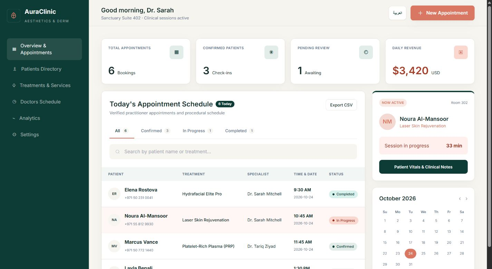

# AuraClinic Dashboard | لوحة أورا كلينك

A clinic dashboard that brings appointment scheduling, status filters, search, and CSV export into one clear workspace. Responsive appointment cards replace the desktop table on mobile, with full Arabic and English layouts.

[Live demo](https://eng-ayatnassar.github.io/auraclinic-dashboard/) · [Source code](https://github.com/eng-ayatnassar/auraclinic-dashboard) · [Ayat Nassar's portfolio](https://eng-ayatnassar.github.io/)



## Overview

Designed and developed by **Ayat Nassar** as a bilingual front-end portfolio project. The interface supports English and Arabic RTL, responsive layouts, and practical client-side interactions.

## Features

- Appointment creation with responsive table/card views
- Search by patient or treatment and status filters
- CSV export with safe spreadsheet text handling
- Bilingual interface, mobile navigation and demo notes panel

## Tech stack

HTML5 · JavaScript · Tailwind CSS · Vite

## Run locally

Requires **Node.js 22.12 or newer**.

```bash
npm ci
npm run dev
```

On Windows, you can also run `start.cmd`.

## Production build

```bash
npm run build
npm run preview
```

The build is written to `dist/`. Relative asset paths support deployment under a GitHub Pages repository path.

## Demo scope

**Frontend Demo.** Demo appointments are held in memory and reset on reload. No medical records or backend are connected; sidebar sections are illustrative navigation. Use fictional input when trying forms. External imagery and fonts depend on their providers.

## Deployment

The GitHub Actions workflow installs locked dependencies, checks known high-severity advisories, builds, and deploys to GitHub Pages on pushes to `main`. Pull requests run the build without deployment. Repository Pages settings use **GitHub Actions** as the source.

Source, lockfiles, and preview images are tracked. `node_modules/`, `dist/`, secrets, and local logs are excluded.

## بالعربية

لوحة تحكم تجمع إنشاء المواعيد والبحث وتصفية الحالات وتصدير CSV في مساحة عمل واضحة، مع بطاقات مواعيد مناسبة للموبايل بدلاً من الجدول ودعم كامل لاتجاهي العربية والإنجليزية.

- إنشاء المواعيد وعرضها كجدول أو بطاقات
- البحث باسم المريض أو العلاج وتصفية الحالات
- تصدير CSV مع معالجة آمنة للنصوص
- واجهة ثنائية اللغة وتنقّل للموبايل وملاحظات توضيحية

هذا المشروع عرض Frontend لمعرض الأعمال، وليس خدمة تجارية متصلة بخادم أو نظام دفع أو حسابات حقيقية.
